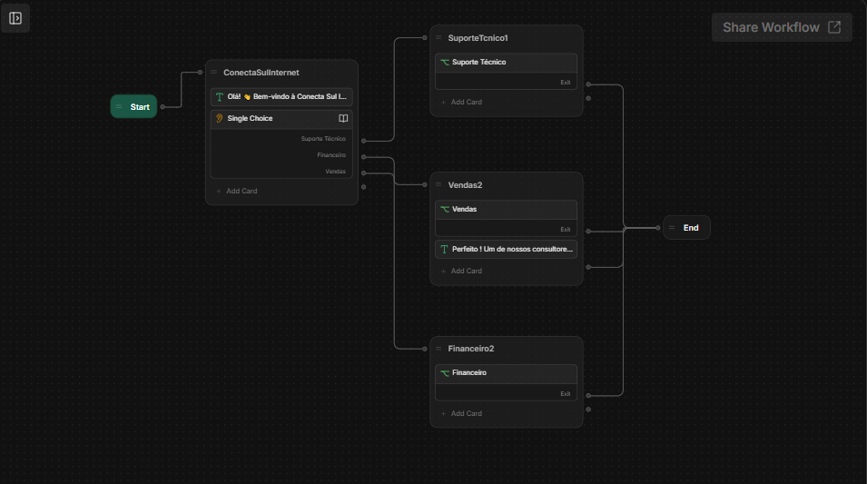
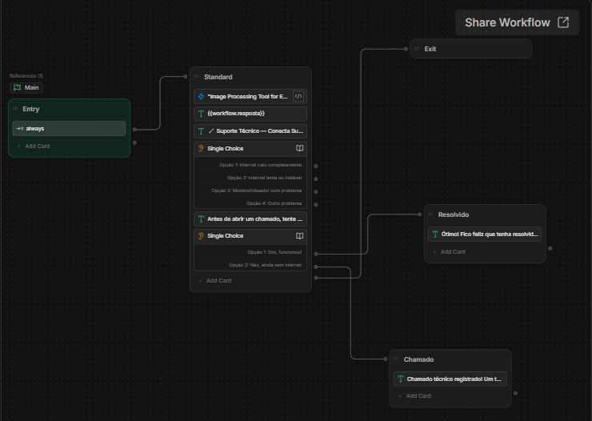
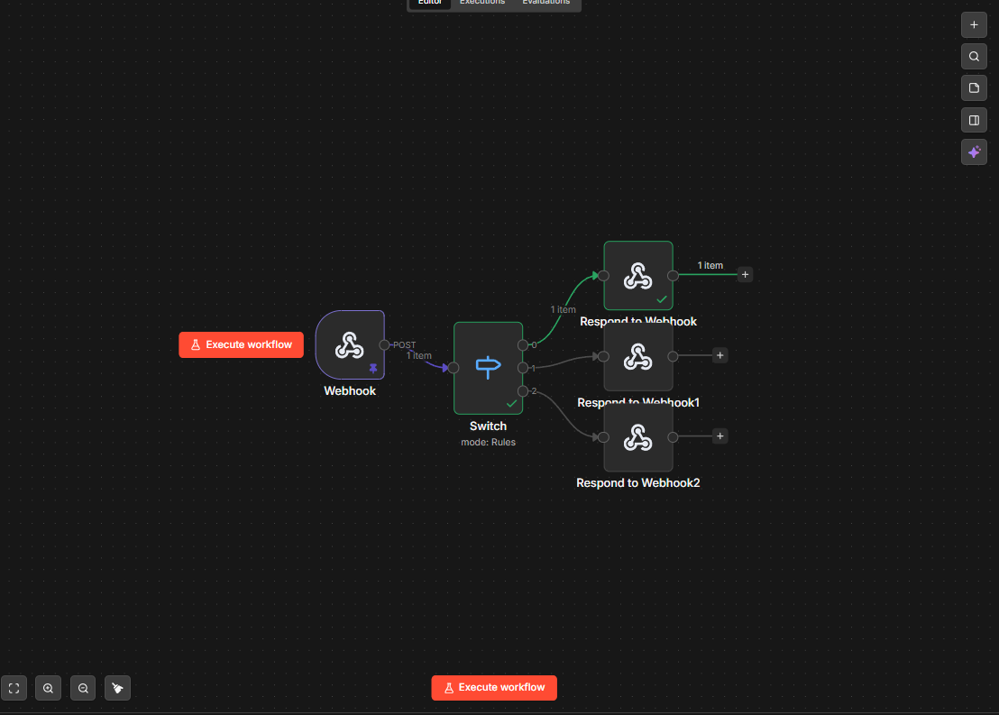
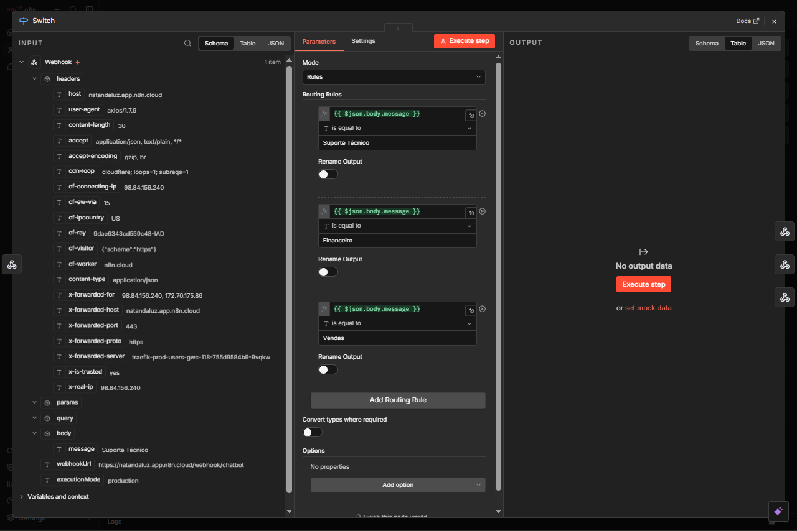
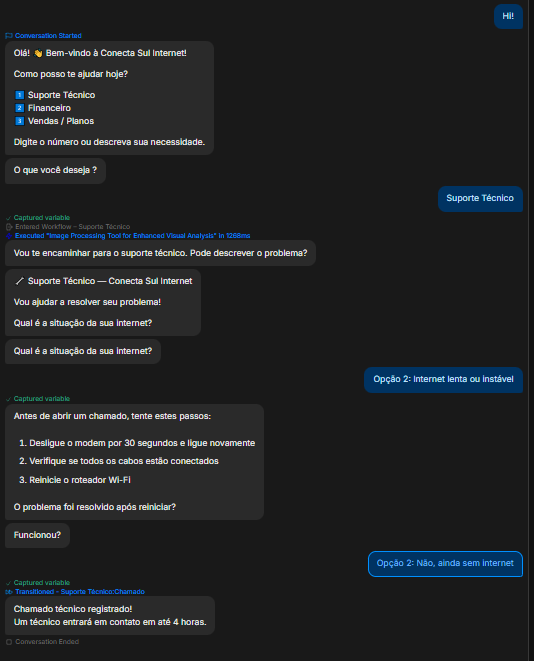

# Webhook Integration for Botpress Chatbot + n8n


## 📖 About the project

**Chatbot Webhook Integration** demonstrates the integration between a chatbot developed in Botpress and an automation workflow created in n8n. Communication between the systems takes place through HTTP Webhooks, while the automation environment can run in a Docker container.

The application simulates the automated customer service of the fictional company **Conecta Sul Internet**. The solution separates the conversational interface, managed by Botpress, from the processing logic, handled by n8n workflows. This separation results in a decoupled, modular, and organized architecture.

The goal of this project is to demonstrate, in a practical way, how chatbot platforms can serve as an entry interface for automated processes and integrations between services.

## Integration architecture

```text
User
  ↓
Chatbot (Botpress)
  ↓
Webhook HTTP
  ↓
n8n (Workflow Automation)
  ↓
Switch Node
  ↓
Respond to Webhook
  ↓
Response to the chatbot
```

### Application flow

1. The user starts the conversation;
2. the chatbot presents the available departments;
3. Botpress sends an HTTP request to n8n;
4. the Webhook Node receives the request;
5. the Switch Node identifies the selected department;
6. the corresponding workflow is executed;
7. Respond to Webhook returns a JSON response;
8. Botpress presents the response to the user.

## ✨ Features

- Chatbot developed in Botpress Studio;
- customer service menu for Technical Support, Finance, and Sales;
- department-specific workflows;
- communication between Botpress and n8n through HTTP Webhooks;
- automated request processing in n8n;
- department-based routing with the Switch Node;
- responses returned in JSON format by Respond to Webhook;
- n8n running in a Docker environment;
- chatbot export in `.bpz` format;
- workflow export in `.json` format;
- modular workflow-based architecture.

## 🖼️ Screenshots

### Botpress architecture



### Workflow structure



### n8n automation



### n8n workflow



### Chatbot test



## 🚀 Technologies

- **Botpress Studio:** creation of the chatbot's conversational interface and flows;
- **n8n:** request processing and workflow automation;
- **Docker:** running n8n in an isolated and reproducible environment;
- **HTTP Webhooks:** communication between Botpress and n8n;
- **JSON:** format used to exchange data between the systems.

## ⚙️ How to run

### Prerequisites

- Git;
- Docker;
- Docker Compose;
- access to Botpress Studio.

### Clone the repository

```bash
git clone https://github.com/NatanLuz/chatbot-webhook-integration-botpress-n8n.git
cd chatbot-webhook-integration-botpress-n8n
```

You can also download the files directly from GitHub.

### Run n8n with Docker

Start the container in the background:

```bash
docker run -d --name n8n -p 5678:5678 n8nio/n8n
```

After it starts, access the dashboard at:

```text
http://localhost:5678
```

### Run n8n with Docker Compose

Alternatively, run this command from the project root:

```bash
docker compose up -d
```

The service will start in the background through the `docker-compose.yml` file, exposing port `5678`, using the persistent `n8n_data` volume, and applying the `restart: unless-stopped` restart policy.

### Import the workflow into n8n

1. Open `http://localhost:5678`;
2. select **Import Workflow**;
3. import the `n8n/workflow.json` file.

### Import the chatbot into Botpress

1. Open Botpress Studio;
2. select **Import Bot**;
3. import the `botpress/conecta-sul-chatbot.bpz` file.

## 📂 Project structure

The repository keeps the chatbot export, workflow export, and documentation images in separate directories:

```text
.
├── botpress/
│   └── conecta-sul-chatbot.bpz
├── n8n/
│   └── workflow.json
├── docs/
│   ├── arquiteturabotpress.png
│   ├── arquiteturabotpress2.png
│   ├── automacaon8n.png
│   ├── n8n-workflow.png
│   └── testechatbot.png
└── README.md
```

- `botpress/conecta-sul-chatbot.bpz`: chatbot export;
- `n8n/workflow.json`: automation workflow export;
- `docs/`: solution diagrams and screenshots;
- `README.md`: project technical documentation.

## 🌐 Deployment

This is a platform integration project. n8n can run locally with Docker or be hosted on a compatible server. Botpress can be used locally or in its cloud environment, depending on the edition being used.

For a production environment, the architecture can be adapted by publishing the services, configuring the Webhook URLs, persisting n8n data, and applying the necessary security controls.

## 👤 Author

**Natan Da Luz**

- LinkedIn: [linkedin.com/in/natandaluz](https://www.linkedin.com/in/natandaluz/)

- Portfólio: [portfolionatan.vercel.app](https://portfolionatan.vercel.app/)

- E-mail: [natandaluz01@gmail.com](mailto:natandaluz01@gmail.com)

## 📄 License

This project does not currently have a defined license.
